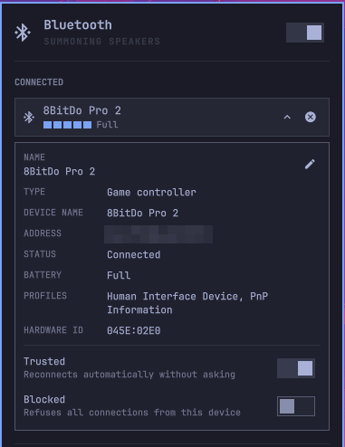

# Bluechip

A drop-in replacement for Omarchy's Bluetooth bar widget. It adds a details
card for each device, renaming, trust/block switches, device-type icons, and a
battery gauge that also covers game controllers whose battery isn't reported
over Bluetooth.

It's built from Omarchy's own widget, so it uses the same shell components,
follows your theme, and sits in the same place in the bar.



## Features

- **Everything the built-in panel does:** power toggle, scan, pair, connect,
  disconnect and forget.
- **Battery gauge** under each connected device. It has five segments in your
  theme's accent colour, turning to the theme's urgent colour when low, and
  shows a bolt while charging.
  - Battery comes from Bluetooth when the device reports it there, or from the
    input driver otherwise. That covers controllers on drivers like xpadneo
    (Xbox-mode controllers such as the 8BitDo Pro 2) and others that publish
    to `/sys/class/power_supply`.
  - Drivers that report only a level (Critical / Low / Normal / High / Full)
    map one-to-one onto the five segments. Percentages fill one segment per
    20%.
- **Device-type icons** for controllers, headphones, headsets, speakers,
  keyboards, mice, phones, computers and more.
- **Details card** (the ⓘ button or `i`) shows name, type, the device's own
  name, address, status, battery, Bluetooth profiles and hardware ID.
- **Rename** (the pencil button or `r`). This sets the Bluetooth alias, so the
  new name shows up everywhere that uses BlueZ. Save an empty name to go back
  to the device's own name.
- **Trusted switch**, so the device reconnects automatically without asking,
  and a **Blocked switch** to refuse all connections from it.
- **Keyboard:** `j`/`k` move, `Enter` connects or disconnects, `i` toggles
  details, `r` renames, `x` forgets, `b` toggles Bluetooth, `Esc` closes.
- **Shortcut:** the default `Super+Ctrl+B` opens Bluechip once it's enabled.

## Requirements

- Omarchy 4 (Quattro)
- `bluez-utils` (`bluetoothctl`) and `jq`, both installed on Omarchy by
  default

## Install

```bash
omarchy plugin add https://github.com/chizzler/Bluechip.git --enable
```

Enabling Bluechip puts it in the built-in Bluetooth widget's place in the bar
and leaves the rest of your bar layout alone. If you install without
`--enable`, enable it later with:

```bash
omarchy plugin enable io.github.chizzler.bluechip
```

## Update

```bash
omarchy plugin update io.github.chizzler.bluechip
```

## Remove

```bash
omarchy plugin remove io.github.chizzler.bluechip
```

This removes the plugin and restores Omarchy's built-in Bluetooth widget.

## Notes

- Renaming, trusting and blocking change BlueZ device settings, the same as
  `bluetoothctl set-alias`, `trust` and `block`. Bluechip doesn't change any
  other configuration.
- Battery details come from a small read-only helper (`bt-details`). It runs
  only while the panel is open: when it opens, every 10 seconds, and when
  connections change. It reads `bluetoothctl info` and
  `/sys/class/power_supply`.
- A device shows a battery gauge only if its driver or Bluetooth reports a
  battery.

## License

MIT. See [LICENSE](LICENSE). Bluechip is derived from Omarchy's built-in
Bluetooth widget (MIT, © David Heinemeier Hansson).

Development notes are in [DEVELOPMENT.md](DEVELOPMENT.md).
